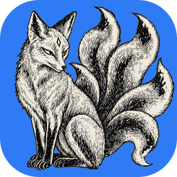

<p align="center">
  
</p>

<h1 align="center">PhotoCraft (techneissa's fork)</h1>

<p align="center">
  <b>A personal fork of <a href="https://github.com/storytold/photocraft">PhotoCraft</a>, the open-source image editor written in pure Rust.</b><br>
  The official app plus a few features of my own, built for macOS.
</p>

<p align="center">
  <a href="https://discord.gg/artcraft"></a>
</p>

<p align="center">
  <a href="https://getartcraft.com/apps/photocraft"><b>PhotoCraft on getartcraft.com</b></a> ·
  <a href="https://github.com/storytold/photocraft">Official repo</a> ·
  <a href="https://discord.gg/artcraft">Discord</a>
</p>

<p align="center">
  
</p>

<table>
  <tr>
    <td width="50%" valign="top">
      
      <br><b>Adjustment layers</b><br>
      Levels, Curves, Vibrance and more, all editable and maskable.
    </td>
    <td width="50%" valign="top">
      
      <br><b>Layer styles</b><br>
      Shadows, glows, strokes and overlays, live on any layer.
    </td>
  </tr>
  <tr>
    <td width="50%" valign="top">
      
      <br><b>Selections and masks</b><br>
      Marquees, lassos, Magic Wand and Select Subject, turned into masks in one click.
    </td>
    <td width="50%" valign="top">
      
      <br><b>Type</b><br>
      Point and paragraph text, edited right on the canvas.
    </td>
  </tr>
  <tr>
    <td width="50%" valign="top">
      
      <br><b>Shapes and paths</b><br>
      Shape layers, the Pen tools and vector masks.
    </td>
    <td width="50%" valign="top">
      
      <br><b>Live filter previews</b><br>
      Blurs, distortions and more, previewed on the canvas.
    </td>
  </tr>
  <tr>
    <td width="50%" valign="top">
      
      <br><b>Free Transform and History</b><br>
      Scale, rotate, skew and warp, with full undo history.
    </td>
    <td width="50%" valign="top">
      
      <br><b>Export As</b><br>
      Pick format, quality and scale, with a size estimate.
    </td>
  </tr>
</table>

<sub>Artworks are public domain; sources in <a href="../docs/images/SOURCES.md">SOURCES.md</a>.</sub>

## What I added

**Selection and AI**
- **SAM 3 selection:** Object Selection and Quick Selection pick objects with a click or a dragged box.
- **Select Subject engines:** choose macOS's own cutout, an AI model, SAM 3 or Classic.
- **Refine Hair:** a button in Select and Mask for cleaner hair edges.
- **Remove Subject:** fills with the LaMa model, running on the Mac's GPU.
- **Shared models:** every AI model is stored once, shared with the other Craft apps.

**Layers and editing**
- **Unlocked photos:** a photo opens as a normal layer you can move above or below; Settings › General › Lock the Background Layer brings the lock back.
- **Double Exposure:** Layer ▸ Double Exposure blends the top layer in one step.
- **Live blend in Transform:** Free Transform and the warps show the layer's blend mode while you move it.
- **Place Photos:** Place Embedded on ⇧⌘P, several photos at once, and a Place Photo button in Layers.
- **Open as Layers:** opens a LightCraft photo stack as the layers of one document.
- **Copy Layers to Document:** safer copying between open documents.
- **Levels and Curves:** ⌥-drag to see clipping, and a histogram that is never empty.

**Shortcuts, menus and settings**
- **Keyboard Shortcuts:** chords, conditions, clash warnings, export and import, resizable window.
- **Assign Shortcut…:** right-click any command to give it a key.
- **Command palette:** also on ⌘P.
- **Context menu editor:** hide, reorder and add right-click menu items, with presets.
- **Top bar items:** show or hide each item in the top bar.
- **Searchable dropdowns:** type to filter an open list, like the blend modes.
- **Settings sync:** move every setting to another Mac in one file, or keep them in a sync folder (bottom of Settings › General).
- **Mac keys:** ⌘, opens Settings; ⌘, or Esc closes it.
- **Home screen:** recent files as a grid of previews; hover a preview for its ×, and choose how many show.
- **Updates:** Help ▸ Check for Updates and Settings update to this fork's own builds, never the official release.

**Fixes**
- PSD files with many fonts open without a long wait.
- Cropping with Delete Cropped Pixels off no longer quits the app.
- A few official fixes taken early, for masks, the Polygonal Lasso and Select ▸ Modify.

## About this fork

- **Official code:** comes from [storytold/photocraft](https://github.com/storytold/photocraft) and is merged in often. For PhotoCraft itself (features, downloads, docs), see the official repo.
- **Branches:** `custom` (the default here) is the official `main` plus my features; `main` is a plain copy of the official one.
- **Mac only:** I build and use it on macOS. Other platforms may not build.
- **Full feature list:** [features.md](../fork/features.md), one page per feature in [`fork/`](../fork/).
- **How it works:** updating, building and adding a feature are in [FORK.md](../FORK.md).

Bugs in the official app belong in the [official issues](https://github.com/storytold/photocraft/issues); this fork is a personal build.

## Build

```sh
git clone https://github.com/techneissa/photocraft
cd photocraft
cargo run --release -p photocraft
```

## License

Dual-licensed under [MIT](../LICENSE-MIT) or [Apache-2.0](../LICENSE-APACHE), like the official PhotoCraft. Notices are in [NOTICE](../NOTICE), bundled assets in [ATTRIBUTION.md](../ATTRIBUTION.md).

## Star history (official repo)

[](https://www.star-history.com/?repos=storytold%2Fphotocraft&type=date&legend=top-left)
